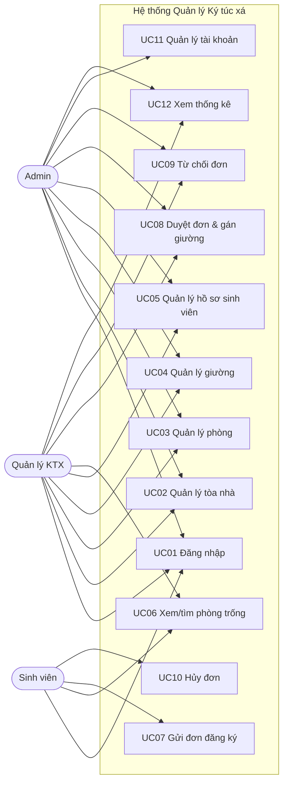

# Use Case – Hệ thống Quản lý Ký túc xá

## 1. Tác nhân (Actors)

| Tác nhân | Mô tả | Quyền hạn chính |
|---|---|---|
| Sinh viên | Sinh viên đang học, có nhu cầu ở KTX | Xem phòng trống, gửi/hủy đơn, xem đơn và hồ sơ của mình |
| Quản lý KTX | Cô quản lý và nhân viên KTX | Quản lý tòa nhà/phòng/giường, hồ sơ sinh viên, duyệt đơn |
| Admin | Quản trị viên hệ thống | Toàn quyền nghiệp vụ + quản lý tài khoản người dùng |
| Hệ thống | Thành phần tự động | Kiểm tra trùng giường, phòng đầy, phân quyền, tính trạng thái |

## 2. Danh sách Use Case

| Mã | Use Case | Tác nhân | Sprint |
|---|---|---|---|
| UC01 | Đăng nhập | Sinh viên, Quản lý, Admin | 1 |
| UC02 | Quản lý tòa nhà (thêm/sửa/xóa/xem) | Quản lý, Admin | 1 |
| UC03 | Quản lý phòng (thêm/sửa/xóa/xem) | Quản lý, Admin | 1 |
| UC04 | Quản lý giường (thêm/xóa/đổi trạng thái) | Quản lý, Admin | 1 |
| UC05 | Quản lý hồ sơ sinh viên | Quản lý, Admin | 1 |
| UC06 | Xem và tìm phòng trống | Sinh viên, Quản lý | 1 |
| UC07 | Gửi đơn đăng ký ở | Sinh viên | 1 |
| UC08 | Duyệt đơn & gán giường | Quản lý, Admin | 1 |
| UC09 | Từ chối đơn đăng ký | Quản lý, Admin | 1 |
| UC10 | Hủy đơn đăng ký | Sinh viên | 1 |
| UC11 | Quản lý tài khoản người dùng | Admin | 1 |
| UC12 | Xem thống kê tổng quan | Quản lý, Admin | 1 |
| UC13 | Quản lý hợp đồng nội trú | Quản lý, Admin | 2 |
| UC14 | Tính phí & hóa đơn | Quản lý, Admin | 2 |
| UC15 | Gửi/nhận thông báo | Quản lý, Sinh viên | 2 |
| UC16 | Gửi yêu cầu sửa chữa | Sinh viên, Quản lý | 2 |
| UC17 | Đăng tin nhượng chỗ | Sinh viên | 3 |
| UC18 | Gửi yêu cầu nhận chỗ | Sinh viên | 3 |
| UC19 | Duyệt nhượng chỗ | Quản lý, Admin | 3 |

## 3. Sơ đồ Use Case tổng quát

## 4. Đặc tả chi tiết các Use Case chính

### UC01 – Đăng nhập

| Mục | Nội dung |
|---|---|
| Tác nhân | Sinh viên, Quản lý, Admin |
| Mô tả | Người dùng đăng nhập bằng tài khoản được cấp để truy cập hệ thống theo vai trò |
| Tiền điều kiện | Người dùng đã có tài khoản đang hoạt động |
| Hậu điều kiện | Phiên đăng nhập được tạo; người dùng thấy menu đúng vai trò |

**Luồng chính**
1. Người dùng mở trang đăng nhập.
2. Nhập tên đăng nhập và mật khẩu.
3. Hệ thống kiểm tra tài khoản, mật khẩu và trạng thái hoạt động.
4. Hệ thống tạo token và trả về thông tin người dùng.
5. Hệ thống chuyển đến trang chủ tương ứng vai trò.

**Luồng thay thế**
- 3a. Thiếu tên đăng nhập/mật khẩu → báo lỗi 400.
- 3b. Sai tài khoản/mật khẩu hoặc tài khoản bị khóa → báo lỗi 401.

**Quy tắc:** Không tiết lộ tài khoản có tồn tại hay không; mật khẩu băm bằng scrypt.

---

### UC05 – Quản lý hồ sơ sinh viên

| Mục | Nội dung |
|---|---|
| Tác nhân | Quản lý KTX, Admin |
| Mô tả | Thêm, sửa, xóa và tra cứu hồ sơ sinh viên nội trú |
| Tiền điều kiện | Đã đăng nhập với vai trò quản lý/admin |
| Hậu điều kiện | Hồ sơ sinh viên được cập nhật trong CSDL |

**Luồng chính**
1. Quản lý mở màn hình Sinh viên.
2. Hệ thống hiển thị danh sách và bộ lọc.
3. Quản lý chọn thêm mới hoặc sửa một hồ sơ.
4. Nhập MSSV, họ tên, giới tính, ngày sinh, lớp, khoa, liên hệ, trạng thái.
5. Hệ thống kiểm tra MSSV duy nhất và dữ liệu hợp lệ.
6. Hệ thống lưu và hiển thị lại danh sách.

**Luồng thay thế**
- 5a. MSSV trùng → báo lỗi, không lưu.
- 5b. Thiếu trường bắt buộc → báo lỗi.
- 3a. Tra cứu: nhập MSSV/tên/lớp → hệ thống lọc danh sách.

**Quy tắc:** Không xóa sinh viên đang nội trú; sinh viên chỉ xem hồ sơ của mình.

---

### UC07 – Gửi đơn đăng ký ở

| Mục | Nội dung |
|---|---|
| Tác nhân | Sinh viên |
| Mô tả | Sinh viên chọn phòng còn trống và gửi đơn đăng ký ở KTX |
| Tiền điều kiện | Đăng nhập vai trò sinh viên; hồ sơ liên kết; chưa có giường; không có đơn chờ |
| Hậu điều kiện | Đơn được tạo với trạng thái `pending` |

**Luồng chính**
1. Sinh viên mở màn hình Phòng trống.
2. Hệ thống hiển thị các phòng còn ít nhất một giường trống.
3. Sinh viên chọn phòng (hoặc không chỉ định) và nhập ghi chú.
4. Sinh viên bấm Gửi đơn.
5. Hệ thống kiểm tra điều kiện và tạo đơn chờ duyệt.
6. Hệ thống hiển thị đơn trong mục “Đơn của tôi”.

**Luồng thay thế**
- 5a. Sinh viên đã có giường → báo lỗi.
- 5b. Đã có đơn chờ → báo lỗi.
- 5c. Phòng chỉ định đã đầy/bảo trì → báo lỗi.

---

### UC08 – Duyệt đơn & gán giường

| Mục | Nội dung |
|---|---|
| Tác nhân | Quản lý KTX, Admin |
| Mô tả | Quản lý duyệt đơn và chọn giường cụ thể cho sinh viên |
| Tiền điều kiện | Đơn đang `pending`; còn giường trống phù hợp |
| Hậu điều kiện | Đơn `approved`; giường `occupied`; sinh viên được gán giường |

**Luồng chính**
1. Quản lý mở danh sách đơn đăng ký.
2. Chọn một đơn đang chờ và bấm Duyệt.
3. Hệ thống hiển thị phòng còn trống và giường trống.
4. Quản lý chọn phòng, chọn giường, nhập ghi chú duyệt.
5. Hệ thống kiểm tra giường còn trống, phòng hoạt động và chưa đầy.
6. Hệ thống cập nhật giường sang `occupied`, gán giường cho sinh viên, đơn sang `approved`.
7. Hệ thống hiển thị thông tin xếp chỗ cho sinh viên.

**Luồng thay thế**
- 5a. Giường đã có người → báo lỗi 409.
- 5b. Phòng bảo trì/đóng → báo lỗi 409.
- 5c. Phòng đã đầy → báo lỗi 409.
- 5d. Sinh viên đã có giường → báo lỗi 409.

**Quy tắc:** Thao tác duyệt chạy trong transaction để tránh xếp trùng khi có nhiều yêu cầu.

---

### UC09 – Từ chối đơn đăng ký

| Mục | Nội dung |
|---|---|
| Tác nhân | Quản lý KTX, Admin |
| Tiền điều kiện | Đơn đang `pending` |
| Hậu điều kiện | Đơn `rejected`, lưu lý do và người duyệt |

**Luồng chính**
1. Quản lý chọn đơn và bấm Từ chối.
2. Nhập lý do từ chối.
3. Hệ thống cập nhật trạng thái và lưu lịch sử.
4. Sinh viên thấy trạng thái “Từ chối” và lý do.

---

### UC10 – Hủy đơn đăng ký

| Mục | Nội dung |
|---|---|
| Tác nhân | Sinh viên |
| Tiền điều kiện | Đơn của chính sinh viên đang `pending` |
| Hậu điều kiện | Đơn `cancelled`; sinh viên có thể gửi đơn mới |

---

## 5. Ma trận truy vết Use Case → Yêu cầu → Kiểm thử

| Use Case | Yêu cầu | Kiểm thử tích hợp |
|---|---|---|
| UC01 | FR-01, NFR-02, NFR-03 | Test 1, Test 2 |
| UC02 | FR-02 | Test 3 |
| UC03 | FR-03, FR-05 | Test 3 |
| UC04 | FR-04 | Test 3 |
| UC05 | FR-06 | Test 4 |
| UC06 | FR-05 | Test 3 |
| UC07 | FR-07, FR-09, BR-03 | Test 5 |
| UC08 | FR-08, FR-10, BR-02, BR-04, BR-05 | Test 5 |
| UC09 | FR-09 | Test 5 |
| UC10 | FR-09 | Test 5 |
| UC11 | FR-12, NFR-03 | Test 2, Test 6 |
| UC12 | FR-11 | Test 6 |
