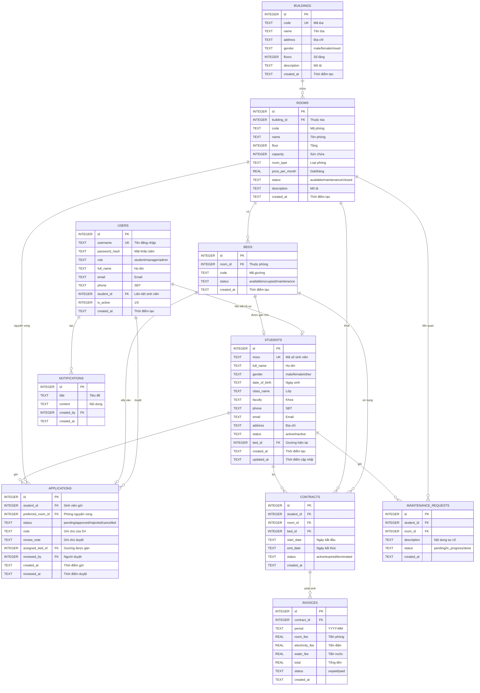
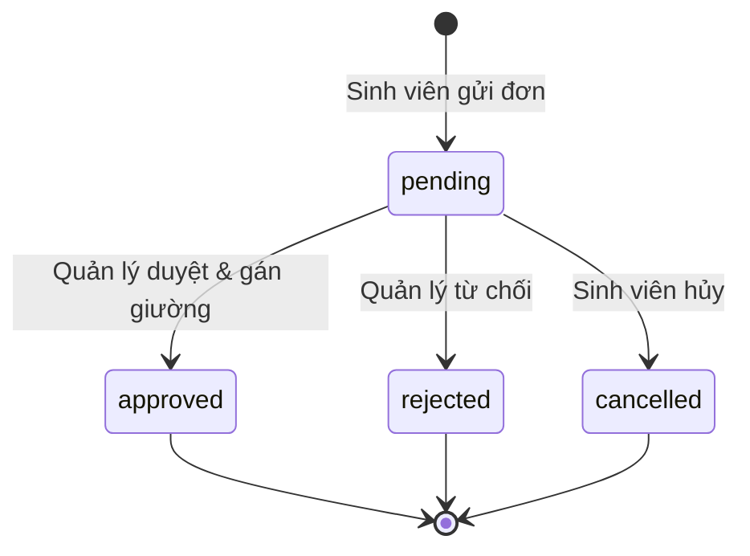

# ERD & Từ điển dữ liệu – Hệ thống Quản lý Ký túc xá

## 1. Sơ đồ quan hệ thực thể (ERD)

> **Phạm vi Sprint 1:** các bảng `buildings`, `rooms`, `beds`, `students`, `users`, `applications` được sử dụng trực tiếp. Các bảng `contracts`, `invoices`, `notifications`, `maintenance_requests` đã được thiết kế sẵn cho Sprint 2 nhưng chưa có giao diện.

## 2. Từ điển dữ liệu

### 2.1. `buildings` – Tòa nhà

| Cột | Kiểu | Ràng buộc | Mô tả |
|---|---|---|---|
| id | INTEGER | PK, AUTOINCREMENT | Khóa chính |
| code | TEXT | NOT NULL, UNIQUE | Mã tòa (A, B, C…) |
| name | TEXT | NOT NULL | Tên tòa |
| address | TEXT | | Địa chỉ |
| gender | TEXT | NOT NULL, CHECK in (male, female, mixed) | Giới tính tòa |
| floors | INTEGER | NOT NULL, CHECK >= 1 | Số tầng |
| description | TEXT | | Mô tả |
| created_at | TEXT | NOT NULL, DEFAULT datetime('now') | Thời điểm tạo |

### 2.2. `rooms` – Phòng

| Cột | Kiểu | Ràng buộc | Mô tả |
|---|---|---|---|
| id | INTEGER | PK, AUTOINCREMENT | Khóa chính |
| building_id | INTEGER | NOT NULL, FK → buildings.id, ON DELETE CASCADE | Tòa nhà |
| code | TEXT | NOT NULL | Mã phòng |
| name | TEXT | | Tên phòng |
| floor | INTEGER | NOT NULL, CHECK >= 1 | Tầng |
| capacity | INTEGER | NOT NULL, CHECK > 0 | Sức chứa tối đa |
| room_type | TEXT | NOT NULL, DEFAULT 'standard' | Loại phòng |
| price_per_month | REAL | NOT NULL, CHECK >= 0 | Giá thuê/tháng |
| status | TEXT | NOT NULL, CHECK in (available, maintenance, closed) | Trạng thái phòng |
| description | TEXT | | Mô tả |
| created_at | TEXT | NOT NULL | Thời điểm tạo |

**Ràng buộc bổ sung:** `UNIQUE(building_id, code)` – mã phòng không trùng trong cùng tòa.

### 2.3. `beds` – Giường

| Cột | Kiểu | Ràng buộc | Mô tả |
|---|---|---|---|
| id | INTEGER | PK, AUTOINCREMENT | Khóa chính |
| room_id | INTEGER | NOT NULL, FK → rooms.id, ON DELETE CASCADE | Phòng |
| code | TEXT | NOT NULL | Mã giường (G1, G2…) |
| status | TEXT | NOT NULL, CHECK in (available, occupied, maintenance) | Trạng thái giường |
| created_at | TEXT | NOT NULL | Thời điểm tạo |

**Ràng buộc bổ sung:** `UNIQUE(room_id, code)` – mã giường không trùng trong phòng.

### 2.4. `students` – Sinh viên

| Cột | Kiểu | Ràng buộc | Mô tả |
|---|---|---|---|
| id | INTEGER | PK, AUTOINCREMENT | Khóa chính |
| mssv | TEXT | NOT NULL, UNIQUE | Mã số sinh viên |
| full_name | TEXT | NOT NULL | Họ tên |
| gender | TEXT | CHECK in (male, female, other) | Giới tính |
| date_of_birth | TEXT | | Ngày sinh (YYYY-MM-DD) |
| class_name | TEXT | | Lớp |
| faculty | TEXT | | Khoa |
| phone | TEXT | | Số điện thoại |
| email | TEXT | | Email |
| address | TEXT | | Địa chỉ |
| status | TEXT | NOT NULL, CHECK in (active, inactive) | Trạng thái hồ sơ |
| bed_id | INTEGER | FK → beds.id, ON DELETE SET NULL | Giường hiện tại |
| created_at | TEXT | NOT NULL | Thời điểm tạo |
| updated_at | TEXT | NOT NULL | Thời điểm cập nhật |

**Ràng buộc bổ sung:** unique index trên `bed_id` (khi khác NULL) – mỗi giường tối đa một sinh viên.

### 2.5. `users` – Tài khoản

| Cột | Kiểu | Ràng buộc | Mô tả |
|---|---|---|---|
| id | INTEGER | PK, AUTOINCREMENT | Khóa chính |
| username | TEXT | NOT NULL, UNIQUE | Tên đăng nhập |
| password_hash | TEXT | NOT NULL | Chuỗi `salt:hash` (scrypt) |
| role | TEXT | NOT NULL, CHECK in (student, manager, admin) | Vai trò |
| full_name | TEXT | NOT NULL | Họ tên |
| email | TEXT | | Email |
| phone | TEXT | | SĐT |
| student_id | INTEGER | FK → students.id, ON DELETE SET NULL | Liên kết hồ sơ SV |
| is_active | INTEGER | NOT NULL, DEFAULT 1 | 1: hoạt động, 0: khóa |
| created_at | TEXT | NOT NULL | Thời điểm tạo |

### 2.6. `applications` – Đơn đăng ký ở

| Cột | Kiểu | Ràng buộc | Mô tả |
|---|---|---|---|
| id | INTEGER | PK, AUTOINCREMENT | Khóa chính |
| student_id | INTEGER | NOT NULL, FK → students.id, ON DELETE CASCADE | Sinh viên gửi |
| preferred_room_id | INTEGER | FK → rooms.id, ON DELETE SET NULL | Phòng nguyện vọng |
| status | TEXT | NOT NULL, CHECK in (pending, approved, rejected, cancelled) | Trạng thái đơn |
| note | TEXT | | Ghi chú của sinh viên |
| review_note | TEXT | | Ghi chú/lý do của quản lý |
| assigned_bed_id | INTEGER | FK → beds.id, ON DELETE SET NULL | Giường được gán |
| reviewed_by | INTEGER | FK → users.id, ON DELETE SET NULL | Người duyệt |
| created_at | TEXT | NOT NULL | Thời điểm gửi |
| reviewed_at | TEXT | | Thời điểm duyệt |

**Ràng buộc bổ sung:** partial unique index `(student_id) WHERE status = 'pending'` – mỗi sinh viên tối đa một đơn chờ.

### 2.7. `contracts` – Hợp đồng nội trú (Sprint 2)

| Cột | Kiểu | Ràng buộc | Mô tả |
|---|---|---|---|
| id | INTEGER | PK | Khóa chính |
| student_id | INTEGER | NOT NULL, FK → students.id | Sinh viên |
| room_id | INTEGER | NOT NULL, FK → rooms.id | Phòng |
| bed_id | INTEGER | NOT NULL, FK → beds.id | Giường |
| start_date | TEXT | NOT NULL | Ngày bắt đầu |
| end_date | TEXT | | Ngày kết thúc |
| status | TEXT | CHECK in (active, expired, terminated) | Trạng thái hợp đồng |
| created_at | TEXT | NOT NULL | Thời điểm tạo |

### 2.8. `invoices` – Hóa đơn (Sprint 2)

| Cột | Kiểu | Ràng buộc | Mô tả |
|---|---|---|---|
| id | INTEGER | PK | Khóa chính |
| contract_id | INTEGER | NOT NULL, FK → contracts.id | Hợp đồng |
| period | TEXT | NOT NULL | Kỳ `YYYY-MM` |
| room_fee | REAL | NOT NULL, DEFAULT 0 | Tiền phòng |
| electricity_fee | REAL | NOT NULL, DEFAULT 0 | Tiền điện |
| water_fee | REAL | NOT NULL, DEFAULT 0 | Tiền nước |
| total | REAL | NOT NULL, DEFAULT 0 | Tổng |
| status | TEXT | CHECK in (unpaid, paid) | Trạng thái thanh toán |
| created_at | TEXT | NOT NULL | Thời điểm tạo |

**Ràng buộc bổ sung:** `UNIQUE(contract_id, period)`.

### 2.9. `notifications` – Thông báo (Sprint 2)

| Cột | Kiểu | Ràng buộc | Mô tả |
|---|---|---|---|
| id | INTEGER | PK | Khóa chính |
| title | TEXT | NOT NULL | Tiêu đề |
| content | TEXT | NOT NULL | Nội dung |
| created_by | INTEGER | FK → users.id | Người tạo |
| created_at | TEXT | NOT NULL | Thời điểm tạo |

### 2.10. `maintenance_requests` – Yêu cầu sửa chữa (Sprint 2)

| Cột | Kiểu | Ràng buộc | Mô tả |
|---|---|---|---|
| id | INTEGER | PK | Khóa chính |
| student_id | INTEGER | NOT NULL, FK → students.id | Sinh viên gửi |
| room_id | INTEGER | FK → rooms.id | Phòng liên quan |
| description | TEXT | NOT NULL | Nội dung sự cố |
| status | TEXT | CHECK in (pending, in_progress, done) | Trạng thái xử lý |
| created_at | TEXT | NOT NULL | Thời điểm tạo |

## 3. Quy tắc toàn vẹn & chỉ mục

| Tên | Loại | Mục đích |
|---|---|---|
| `ux_students_bed` | UNIQUE INDEX (bed_id) WHERE bed_id IS NOT NULL | Mỗi giường tối đa 1 sinh viên |
| `ux_applications_pending_student` | UNIQUE INDEX (student_id) WHERE status='pending' | Mỗi SV tối đa 1 đơn chờ |
| `ix_rooms_building` | INDEX (building_id) | Lọc phòng theo tòa |
| `ix_beds_room` | INDEX (room_id) | Lấy giường theo phòng |
| `ix_students_name` | INDEX (full_name) | Tra cứu theo tên |
| `ix_students_class` | INDEX (class_name) | Tra cứu theo lớp |
| `ix_applications_st` | INDEX (student_id) | Lấy đơn của sinh viên |
| `ix_applications_stt` | INDEX (status) | Lọc đơn theo trạng thái |

## 4. Ánh xạ trạng thái

**Giường:** `available` → `occupied` (khi duyệt đơn); `available` ↔ `maintenance` (quản lý đổi trạng thái); `occupied` → `available` (Sprint 2 – trả phòng).

## 5. Ghi chú thiết kế

1. Dùng SQLite cho Sprint 1 để nhóm clone và chạy ngay, không cần cài máy chủ CSDL.
2. Schema viết bằng SQL thuần trong `server/src/schema.sql`, có thể chuyển sang MySQL/PostgreSQL khi triển khai thật.
3. Toàn bộ thao tác xếp chỗ chạy trong transaction `BEGIN IMMEDIATE` để tránh xếp trùng.
4. Các trường thời gian lưu dạng TEXT ISO (`YYYY-MM-DD HH:MM:SS`) để tương thích SQLite.
