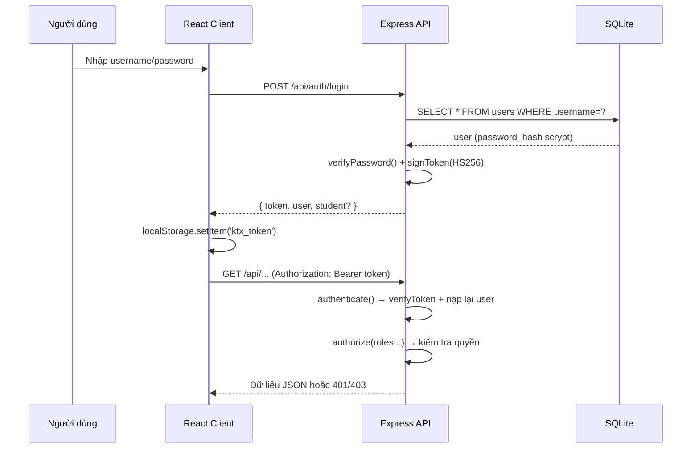
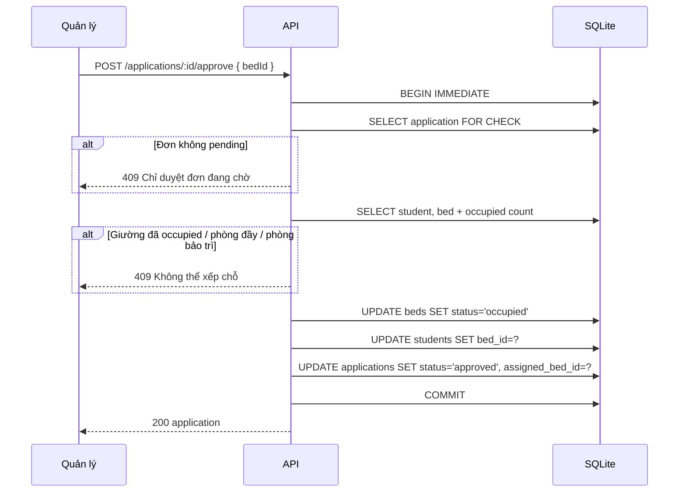

# Kiến trúc hệ thống & đặc tả API

| Thông tin | Nội dung |
|---|---|
| Dự án | Hệ thống Quản lý Ký túc xá (QLKTX) |
| Phiên bản | 1.0 – Sprint 1 |
| Người lập | Phan Phạm Tuấn Anh (Kiến trúc & CSDL) |
| Công nghệ | Node.js 24 + Express 4 + React 18 (Vite 6) + SQLite (`node:sqlite`) |

## 1. Kiến trúc tổng thể (3 lớp)

```
┌──────────────────────────────────────────────────────────────┐
│                    TRÌNH DUYỆT (Browser)                     │
│  React 18 + React Router 6 + Vite                            │
│  Trang: Đăng nhập, Dashboard, Tòa nhà, Phòng, SV, Đơn, Users │
└───────────────────────────┬──────────────────────────────────┘
                            │ HTTP/JSON (fetch)
                            │ Authorization: Bearer <token>
┌───────────────────────────▼──────────────────────────────────┐
│                   TẦNG ỨNG DỤNG (Express)                    │
│  app.js → routes/*.js → middleware.js → serializers.js        │
│  auth.js (scrypt + token HS256), errors.js (HttpError)        │
│  transaction() bọc thao tác xếp chỗ                           │
└───────────────────────────┬──────────────────────────────────┘
                            │ SQL đồng bộ (DatabaseSync)
┌───────────────────────────▼──────────────────────────────────┐
│                     TẦNG DỮ LIỆU (SQLite)                    │
│  server/data/ktx.db · schema.sql · seed.js                   │
└──────────────────────────────────────────────────────────────┘
```

**Đặc điểm kiến trúc**

- **Tách frontend/backend** rõ ràng, giao tiếp qua REST API JSON.
- **Monorepo npm workspaces**: `server/` và `client/` dùng chung `package.json` gốc.
- **Stateless backend**: mọi trạng thái phiên nằm trong token; token lưu ở `localStorage` phía client.
- **SQLite nhúng**: không cần cài máy chủ CSDL, cả nhóm clone là chạy được.
- **Transaction `BEGIN IMMEDIATE`** cho nghiệp vụ duyệt đơn để chống xếp trùng giường.

## 2. Cấu trúc thư mục

```
ktx-management/
├── package.json              # npm workspaces + script dev/seed/test/build
├── README.md
├── docs/                     # tài liệu Sprint 1 (01 → 10, wireframes, slides)
├── server/
│   ├── package.json
│   ├── data/ktx.db           # CSDL SQLite (sinh tự động, không commit)
│   ├── src/
│   │   ├── index.js          # khởi động server + seed lần đầu
│   │   ├── app.js            # khởi tạo Express, mount routes, error handler
│   │   ├── config.js         # PORT, DB_PATH, JWT_SECRET, TOKEN_TTL
│   │   ├── db.js             # DatabaseSync + initSchema + transaction
│   │   ├── schema.sql        # toàn bộ schema CSDL
│   │   ├── auth.js           # hashPassword, verifyPassword, signToken, verifyToken
│   │   ├── middleware.js     # authenticate, authorize(...roles)
│   │   ├── errors.js         # HttpError + helper 400/401/403/404/409
│   │   ├── serializers.js    # chuyển row snake_case → DTO camelCase
│   │   ├── seed.js           # dữ liệu mẫu + tài khoản demo
│   │   └── routes/
│   │       ├── auth.js       # /api/auth
│   │       ├── buildings.js  # /api/buildings
│   │       ├── rooms.js      # /api/rooms
│   │       ├── beds.js       # /api/beds
│   │       ├── students.js   # /api/students
│   │       ├── applications.js # /api/applications
│   │       ├── users.js      # /api/users
│   │       └── stats.js      # /api/stats
│   └── test/integration.test.js
└── client/
    ├── index.html
    ├── vite.config.js        # proxy /api → localhost:4000
    └── src/
        ├── main.jsx
        ├── App.jsx           # định tuyến + RequireRole
        ├── api.js            # fetch wrapper + hàm format
        ├── styles.css        # design system dùng chung
        ├── auth/AuthContext.jsx
        ├── components/
        │   ├── Layout.jsx    # layout + sidebar + menu theo vai trò
        │   ├── ProtectedRoute.jsx
        │   ├── Toast.jsx
        │   └── ui.jsx        # PageHeader, Badge, Modal, Field, StatCard...
        └── pages/
            ├── Login.jsx
            ├── Dashboard.jsx
            ├── Buildings.jsx
            ├── Rooms.jsx
            ├── Students.jsx
            ├── Applications.jsx
            ├── AvailableRooms.jsx
            ├── Profile.jsx
            └── Users.jsx
```

## 3. Công nghệ & lý do chọn

| Thành phần | Công nghệ | Lý do |
|---|---|---|
| Runtime | Node.js 24 | Có sẵn `node:sqlite`, không cần native module |
| Web framework | Express 4 | Đơn giản, quen thuộc, dễ đọc với nhóm |
| CSDL | SQLite (`node:sqlite` – `DatabaseSync`) | Không cài đặt, file đơn, dễ backup |
| Frontend | React 18 + Vite 6 | Build nhanh, HMR, JSX rõ ràng |
| Định tuyến | React Router 6 | Route lồng nhau + bảo vệ theo vai trò |
| Xác thực | scrypt + HMAC-SHA256 token | Không phụ thuộc thư viện ngoài, đủ an toàn cho đồ án |
| Kiểm thử | `node --test` + `fetch` | Tích hợp sẵn, không cần framework ngoài |

## 4. Luồng xác thực & phân quyền



**Quy tắc bảo mật**

1. Mật khẩu băm bằng `scrypt` với salt 16 byte, lưu dạng `salt:hash`.
2. Token HS256 tự cài đặt: `header.payload.signature`, có `iat`/`exp` (mặc định 12 giờ).
3. `authenticate` nạp lại user từ CSDL mỗi request → khóa tài khoản có hiệu lực ngay.
4. Sai đăng nhập trả cùng một thông điệp, không phân biệt tài khoản có tồn tại.
5. Client tự xóa token và điều hướng về `/login` khi nhận 401.
6. `RequireRole` ở client chỉ là lớp UX; quyền thực thi nằm ở `authorize` phía server.

## 5. Ma trận phân quyền

| Chức năng | Sinh viên | Quản lý KTX | Admin |
|---|:---:|:---:|:---:|
| Đăng nhập / xem thông tin bản thân | ✅ | ✅ | ✅ |
| Xem tòa nhà, phòng, giường | ✅ (chỉ đọc) | ✅ | ✅ |
| Thêm/sửa/xóa tòa nhà, phòng, giường | ❌ | ✅ | ✅ |
| Xem/tìm phòng trống | ✅ | ✅ | ✅ |
| Quản lý hồ sơ sinh viên | ❌ | ✅ | ✅ |
| Xem hồ sơ của chính mình | ✅ | — | — |
| Gửi/hủy đơn đăng ký | ✅ | ❌ | ❌ |
| Duyệt/từ chối đơn, gán giường | ❌ | ✅ | ✅ |
| Xem đơn của mình | ✅ | — | — |
| Xem tất cả đơn | ❌ | ✅ | ✅ |
| Dashboard thống kê | ❌ | ✅ | ✅ |
| Quản lý tài khoản người dùng | ❌ | ❌ | ✅ |

## 6. Danh sách API

Base URL: `http://localhost:4000/api`. Mọi endpoint (trừ `/health`, `/auth/login`) yêu cầu `Authorization: Bearer <token>`.

### 6.1. Hệ thống & xác thực

| Method | Endpoint | Quyền | Mô tả |
|---|---|---|---|
| GET | `/health` | Công khai | Kiểm tra API sống |
| POST | `/auth/login` | Công khai | Đăng nhập, trả token + user (+ student nếu là SV) |
| GET | `/auth/me` | Đã đăng nhập | Thông tin người dùng hiện tại |

### 6.2. Tòa nhà

| Method | Endpoint | Quyền | Mô tả |
|---|---|---|---|
| GET | `/buildings` | Đã đăng nhập | Danh sách tòa nhà kèm số phòng |
| GET | `/buildings/:id` | Đã đăng nhập | Chi tiết tòa nhà |
| POST | `/buildings` | manager, admin | Thêm tòa nhà |
| PUT | `/buildings/:id` | manager, admin | Cập nhật tòa nhà |
| DELETE | `/buildings/:id` | manager, admin | Xóa (chặn nếu còn giường đang ở) |

### 6.3. Phòng

| Method | Endpoint | Quyền | Mô tả |
|---|---|---|---|
| GET | `/rooms` | Đã đăng nhập | Danh sách phòng; hỗ trợ `buildingId`, `status`, `q`, `available=true` |
| GET | `/rooms/:id` | Đã đăng nhập | Chi tiết phòng + danh sách giường |
| POST | `/rooms` | manager, admin | Thêm phòng (tự tạo giường theo `bedCount`) |
| PUT | `/rooms/:id` | manager, admin | Cập nhật phòng |
| DELETE | `/rooms/:id` | manager, admin | Xóa phòng (chặn nếu còn người ở) |

### 6.4. Giường

| Method | Endpoint | Quyền | Mô tả |
|---|---|---|---|
| GET | `/beds` | Đã đăng nhập | Danh sách giường; lọc `roomId`, `status` |
| POST | `/beds` | manager, admin | Thêm giường (chặn vượt sức chứa) |
| PUT | `/beds/:id` | manager, admin | Đổi mã/trạng thái (không tự đặt `occupied`) |
| DELETE | `/beds/:id` | manager, admin | Xóa giường (chặn nếu đang có người) |

### 6.5. Sinh viên

| Method | Endpoint | Quyền | Mô tả |
|---|---|---|---|
| GET | `/students` | Đã đăng nhập | Danh sách; lọc `q` (MSSV/tên/lớp), `className`, `status`, `resident` |
| GET | `/students/:id` | Đã đăng nhập | Chi tiết hồ sơ |
| POST | `/students` | manager, admin | Thêm hồ sơ |
| PUT | `/students/:id` | manager, admin | Cập nhật hồ sơ |
| DELETE | `/students/:id` | manager, admin | Xóa (chặn nếu đang nội trú) |

### 6.6. Đơn đăng ký

| Method | Endpoint | Quyền | Mô tả |
|---|---|---|---|
| POST | `/applications` | student | Gửi đơn (tối đa 1 đơn `pending`) |
| GET | `/applications` | Đã đăng nhập | SV chỉ thấy đơn của mình; quản lý thấy tất cả; lọc `status`, `q` |
| GET | `/applications/:id` | Đã đăng nhập | Chi tiết (SV chỉ xem đơn của mình) |
| POST | `/applications/:id/approve` | manager, admin | Duyệt + gán giường (transaction) |
| POST | `/applications/:id/reject` | manager, admin | Từ chối kèm lý do |
| POST | `/applications/:id/cancel` | student | Hủy đơn đang chờ của mình |

### 6.7. Người dùng & thống kê

| Method | Endpoint | Quyền | Mô tả |
|---|---|---|---|
| GET | `/users` | admin | Danh sách tài khoản; lọc `role`, `q` |
| POST | `/users` | admin | Tạo tài khoản |
| PUT | `/users/:id` | admin | Cập nhật vai trò/hồ sơ liên kết/khóa |
| POST | `/users/:id/reset-password` | admin | Đặt lại mật khẩu |
| DELETE | `/users/:id` | admin | Xóa tài khoản (chặn tự xóa & admin cuối) |
| GET | `/stats` | manager, admin | Thống kê tổng quan + 5 đơn gần nhất |

### 6.8. Định dạng lỗi

```json
{ "error": "Thông điệp tiếng Việt", "details": null }
```

| Mã | Ý nghĩa |
|---|---|
| 400 | Dữ liệu đầu vào không hợp lệ |
| 401 | Chưa đăng nhập / token hết hạn / sai mật khẩu |
| 403 | Không đủ quyền |
| 404 | Không tìm thấy dữ liệu |
| 409 | Xung đột nghiệp vụ (trùng MSSV, giường đã có người, phòng đầy…) |
| 500 | Lỗi máy chủ |

## 7. Thiết kế chống xếp trùng giường



Ngoài transaction, CSDL còn có **unique index** `ux_students_bed` trên `students(bed_id)` — lớp bảo vệ cuối cùng ở mức dữ liệu.

## 8. Quy ước mã nguồn & Git

**Đặt tên**

- API/JSON dùng `camelCase`; cột CSDL dùng `snake_case`; chuyển đổi tại `serializers.js`.
- Route file theo danh từ số nhiều (`buildings.js`, `applications.js`).
- Component React đặt tên PascalCase, hook bắt đầu bằng `use`.

**Nhánh Git đề xuất**

| Nhánh | Mục đích |
|---|---|
| `main` | Nhánh ổn định, luôn build & test pass |
| `feature/1.4-auth` | Nhánh cho từng task WBS |
| `fix/<mô-tả>` | Sửa lỗi |

**Commit message:** `<loại>(<phạm vi>): <mô tả ngắn>` — ví dụ `feat(applications): chặn xếp trùng giường`.

## 9. Hướng dẫn chạy

```bash
# 1. Cài dependencies (từ thư mục gốc)
npm install

# 2. Tạo dữ liệu mẫu (tùy chọn – server tự seed lần đầu)
npm run seed

# 3. Chạy đồng thời API (4000) và giao diện (5173)
npm run dev

# 4. Kiểm thử tích hợp
npm test

# 5. Build frontend production
npm run build
```

| Thành phần | URL |
|---|---|
| Giao diện | http://localhost:5173 |
| API | http://localhost:4000/api |
| Health check | http://localhost:4000/api/health |

**Biến môi trường (tùy chọn)**

| Biến | Mặc định | Ý nghĩa |
|---|---|---|
| `PORT` | 4000 | Cổng API |
| `DB_PATH` | `server/data/ktx.db` | Đường dẫn file SQLite |
| `JWT_SECRET` | `ktx-dev-secret-change-me` | Khóa ký token |
| `TOKEN_TTL_SECONDS` | 43200 | Thời hạn token (12 giờ) |
| `CLIENT_ORIGIN` | `http://localhost:5173` | Origin cho CORS |

## 10. Hướng mở rộng (Sprint 2+)

- Thêm bảng đã thiết kế sẵn: `contracts`, `invoices`, `notifications`, `maintenance_requests`.
- Chuyển sang PostgreSQL/MySQL bằng cách thay lớp `db.js`, giữ nguyên schema logic.
- Thêm refresh token, ghi log thao tác (audit log).
- Xuất Excel/PDF báo cáo, gửi thông báo qua email.
