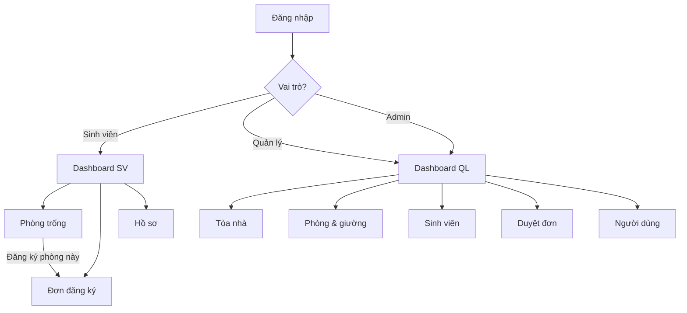

# Wireframe & giao diện dùng chung – Sprint 1

| Thông tin | Nội dung |
|---|---|
| Người thiết kế | Ngô Đức Thắng (UI/UX) |
| Phiên bản | 1.0 – 04/11/2026 |
| Trạng thái | Nhóm đã rà soát; chờ khách hàng xác nhận tại buổi demo 10/11/2026 |
| Bản xem trực quan | [`docs/wireframes/index.html`](wireframes/index.html) |

## 1. Nguyên tắc thiết kế

1. **Một layout dùng chung** cho mọi màn hình sau đăng nhập: sidebar trái + topbar + vùng nội dung.
2. **Menu thay đổi theo vai trò** – sinh viên, quản lý, admin thấy đúng nhóm chức năng của mình.
3. **Thao tác chính luôn ở góc trên phải** (nút “+ Thêm…”) theo thói quen đọc từ trái sang phải.
4. **Bảng dữ liệu + bộ lọc phía trên** cho các màn hình danh sách; modal cho form thêm/sửa để không rời trang.
5. **Phản hồi rõ ràng**: toast thành công/lỗi, badge trạng thái, empty state khi không có dữ liệu.
6. **Tiếng Việt là ngôn ngữ chính**, nhãn ngắn gọn, tránh viết tắt khó hiểu.
7. **Responsive**: sidebar thu thành menu hamburger dưới 960px; form 2 cột chuyển 1 cột.

## 2. Hệ thống thiết kế (design tokens)

| Token | Giá trị | Dùng cho |
|---|---|---|
| Màu chính | `#2563eb` | Nút chính, link, trạng thái active |
| Nền ứng dụng | `#f1f5f9` | Vùng nội dung |
| Sidebar | `#0f172a` | Thanh điều hướng |
| Thành công | `#16a34a` | Badge “Đã duyệt”, “Trống” |
| Cảnh báo | `#d97706` | Badge “Chờ duyệt” |
| Nguy hiểm | `#dc2626` | Nút xóa, badge “Đang ở” |
| Bo góc | 12px | Card, modal |
| Font | Segoe UI / system-ui | Toàn hệ thống |

## 3. Layout dùng chung

```
┌────────────┬──────────────────────────────────────────────────────┐
│  🏠 QLKTX  │  ☰  Tên trang                          [Vai trò] [Tên]│
│  Nhóm 10   ├──────────────────────────────────────────────────────┤
│            │                                                      │
│ TỔNG QUAN  │   Tiêu đề trang                        [+ Thao tác]   │
│  Trang chủ │   Mô tả ngắn                                          │
│            │                                                      │
│ SINH VIÊN  │   ┌──────────────────────────────────────────────┐   │
│  Phòng trống│  │ Bộ lọc / tìm kiếm                            │   │
│  Đơn ĐK    │  ├──────────────────────────────────────────────┤   │
│  Hồ sơ     │  │ Bảng dữ liệu                                 │   │
│            │  │                                              │   │
│ NGHIỆP VỤ  │  └──────────────────────────────────────────────┘   │
│  Tòa nhà   │                                                      │
│  Phòng     │                                                      │
│  Sinh viên │                                                      │
│  Đơn ĐK    │                                                      │
│            │                                                      │
│ QUẢN TRỊ   │                                                      │
│  Người dùng│                                                      │
│ ────────── │                                                      │
│ [Đăng xuất]│                                                      │
└────────────┴──────────────────────────────────────────────────────┘
```

### Menu theo vai trò

| Nhóm menu | Sinh viên | Quản lý KTX | Admin |
|---|:---:|:---:|:---:|
| Tổng quan → Trang chủ | ✅ | ✅ | ✅ |
| Dành cho sinh viên → Phòng trống | ✅ | — | — |
| Dành cho sinh viên → Đơn đăng ký | ✅ | — | — |
| Dành cho sinh viên → Hồ sơ của tôi | ✅ | — | — |
| Nghiệp vụ KTX → Tòa nhà | — | ✅ | ✅ |
| Nghiệp vụ KTX → Phòng & giường | — | ✅ | ✅ |
| Nghiệp vụ KTX → Sinh viên | — | ✅ | ✅ |
| Nghiệp vụ KTX → Đơn đăng ký | — | ✅ | ✅ |
| Quản trị hệ thống → Người dùng | — | — | ✅ |

## 4. Danh sách màn hình

| Mã | Màn hình | Vai trò | Thành phần chính |
|---|---|---|---|
| WF-01 | Đăng nhập | Công khai | Logo, form, nút chọn nhanh tài khoản demo |
| WF-02 | Dashboard quản lý | manager, admin | 6 thẻ thống kê, tỷ lệ lấp đầy, lối tắt, đơn gần đây |
| WF-03 | Dashboard sinh viên | student | Phòng hiện tại, tòa, MSSV, đơn chờ, lối tắt |
| WF-04 | Quản lý tòa nhà | manager, admin | Bảng tòa nhà, modal thêm/sửa |
| WF-05 | Phòng & giường | manager, admin | Bộ lọc, bảng phòng, modal giường |
| WF-06 | Hồ sơ sinh viên | manager, admin | Bộ lọc MSSV/tên/lớp, bảng, modal hồ sơ |
| WF-07 | Duyệt đơn | manager, admin | Bảng đơn, modal chọn phòng + giường |
| WF-08 | Phòng trống (SV) | student | Lưới thẻ phòng, nút “Đăng ký phòng này” |
| WF-09 | Đơn đăng ký (SV) | student | Form gửi đơn + bảng đơn của tôi |
| WF-10 | Hồ sơ của tôi | student | 2 thẻ thông tin cá nhân & nơi ở |
| WF-11 | Quản lý người dùng | admin | Bảng tài khoản, modal tạo/sửa, đặt lại mật khẩu |

## 5. Đặc tả wireframe chi tiết

### WF-01 – Đăng nhập

- Nền tối gradient, thẻ trắng giữa màn hình (max-width 430px).
- Logo + tên hệ thống + dòng “Nhóm 10 · IT3180”.
- Trường: Tên đăng nhập, Mật khẩu; nút “Đăng nhập” chiếm toàn bộ chiều rộng.
- Khu “Tài khoản demo”: 3 nút bấm nhanh (Admin / Quản lý / Sinh viên) tự điền form.
- Lỗi hiển thị trong alert đỏ ngay trên nút đăng nhập.

### WF-02 – Dashboard quản lý

- 6 thẻ số liệu: Tòa nhà, Phòng, Tổng giường, SV nội trú, Giường trống, Đơn chờ duyệt.
- Thẻ “Tỷ lệ lấp đầy” có progress bar + chi tiết giường đang ở/trống/bảo trì.
- Thẻ “Lối tắt nghiệp vụ”: 4 nút đến Tòa nhà, Phòng, Sinh viên, Đơn.
- Bảng “Đơn đăng ký gần đây”: 5 đơn mới nhất kèm badge trạng thái.

### WF-04/05/06 – Màn hình danh sách nghiệp vụ

- PageHeader: tiêu đề + mô tả + nút “+ Thêm…”.
- Thanh filter: ô tìm kiếm (debounce 250ms), select lọc, checkbox.
- Bảng: cột thông tin chính, cột trạng thái dùng badge, cột “Thao tác” chứa nút nhỏ Sửa/Xóa.
- Modal form 2 cột, nút Hủy/Lưu ở footer; ESC hoặc click nền để đóng.
- Empty state có icon + hướng dẫn khi danh sách trống.

### WF-05 – Modal giường

- Tiêu đề “Giường của phòng A101”.
- Dòng tóm tắt: sức chứa, số giường hiện có; ô nhập mã giường mới + nút thêm.
- Mỗi giường là một ô: mã, badge trạng thái, nút Bảo trì/Mở lại/Xóa.
- Giường đang ở có nền đỏ nhạt và không có nút xóa.

### WF-07 – Modal duyệt đơn

- Cột trái: thông tin sinh viên, MSSV/lớp, phòng nguyện vọng, ghi chú của SV.
- Cột phải: select phòng còn trống → select giường trống (tải động), textarea ghi chú duyệt.
- Cảnh báo vàng nếu phòng đã hết giường; nút “Duyệt & xếp chỗ” bị disable khi chưa chọn giường.

### WF-08 – Phòng trống (sinh viên)

- Lưới thẻ phòng (auto-fill, min 250px).
- Mỗi thẻ: mã phòng, tên tòa, badge số giường trống, tầng, sức chứa, đã ở, loại phòng, giá/tháng.
- Nút “Đăng ký phòng này” chuyển sang WF-09 với phòng được chọn sẵn.

### WF-09 – Đơn đăng ký (sinh viên)

- Cột trái: form gửi đơn (select phòng + ghi chú). Nếu đã có chỗ hoặc đang có đơn chờ thì hiện alert và khóa form.
- Cột phải: bảng “Đơn của tôi” (phòng mong muốn, ngày gửi, trạng thái, nơi được xếp, nút Hủy).

### WF-11 – Quản lý người dùng (admin)

- Bảng: tên đăng nhập, họ tên, vai trò (badge màu), liên kết sinh viên, trạng thái, thao tác.
- Modal tạo: username, mật khẩu, họ tên, vai trò, email, SĐT; nếu vai trò sinh viên thì bắt buộc chọn hồ sơ chưa liên kết.
- Modal đặt lại mật khẩu riêng, tối thiểu 6 ký tự.

## 6. Luồng điều hướng chính



## 7. Tiêu chí duyệt wireframe

- [x] Có layout dùng chung cho mọi màn hình sau đăng nhập.
- [x] Menu hiển thị đúng theo 3 vai trò.
- [x] Mỗi chức năng Sprint 1 có màn hình tương ứng.
- [x] Form thêm/sửa dùng modal, không rời trang danh sách.
- [x] Trạng thái (chờ duyệt/đã duyệt/từ chối, trống/đang ở/bảo trì) đều có badge màu.
- [x] Có empty state, loading, thông báo lỗi.
- [x] Dùng được trên màn hình 1366×768 trở lên; responsive dưới 960px.
- [ ] Khách hàng xác nhận tại buổi demo 10/11/2026.
