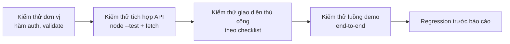

# Kế hoạch kiểm thử & kết quả kiểm thử Sprint 1

| Thông tin | Nội dung |
|---|---|
| Dự án | Hệ thống Quản lý Ký túc xá (QLKTX) |
| Sprint | Sprint 1 (27/10 – 09/11/2026) |
| Người phụ trách | Phạm Mạnh Hùng |
| Phiên bản tài liệu | 1.0 – 09/11/2026 |
| Công cụ | `node --test` (built-in), `fetch`, SQLite tạm |
| Kết quả tổng hợp | **6/6 test tích hợp PASS** · kiểm thử thủ công 18/18 PASS |

## 1. Mục tiêu kiểm thử

1. Xác nhận cả 3 vai trò đăng nhập được và chỉ thấy/được làm đúng chức năng.
2. Xác nhận CRUD tòa nhà – phòng – giường hoạt động và chặn dữ liệu không hợp lệ.
3. Xác nhận tra cứu sinh viên theo MSSV, họ tên, lớp.
4. Xác nhận luồng gửi đơn → duyệt → gán giường chạy đúng.
5. Xác nhận hệ thống **chặn xếp trùng giường** và **chặn xếp vào phòng đầy/bảo trì**.
6. Xác nhận luồng demo Sprint 1 chạy trọn vẹn, không lỗi nghiêm trọng.

## 2. Phạm vi kiểm thử

| Trong phạm vi | Ngoài phạm vi |
|---|---|
| API: auth, buildings, rooms, beds, students, applications, users, stats | Hợp đồng, hóa đơn, thông báo (Sprint 2) |
| Giao diện: 9 trang React + layout + menu theo vai trò | Kiểm thử tải (load test) quy mô lớn |
| CSDL: ràng buộc, unique index, transaction | Kiểm thử bảo mật chuyên sâu (pen-test) |
| Luồng end-to-end đăng ký & xếp chỗ | Đa ngôn ngữ, trình duyệt cũ |

## 3. Môi trường kiểm thử

| Thành phần | Phiên bản / cấu hình |
|---|---|
| OS | Windows 11 (máy thành viên nhóm) |
| Node.js | v24.19.0 |
| npm | 11.17.0 |
| CSDL test | File SQLite tạm trong `os.tmpdir()`, tạo mới mỗi lần chạy |
| Trình duyệt | Chrome / Edge phiên bản mới nhất |
| Lệnh chạy | `npm test` (từ thư mục gốc) |

**Cơ chế cô lập dữ liệu:** test đặt `process.env.DB_PATH` trước khi import app, dùng `seedDatabase({ force: true })`, và xóa file DB trong hook `after()`. Nhờ vậy chạy test không ảnh hưởng dữ liệu demo.

## 4. Chiến lược kiểm thử



- **Tự động:** 6 test tích hợp bao phủ toàn bộ API Sprint 1, chạy bằng một lệnh.
- **Thủ công:** checklist 18 mục trên giao diện thật, thực hiện trước buổi demo.
- **Regression:** chạy lại `npm test` + `npm run build` sau mỗi thay đổi lớn.

## 5. Ánh xạ Acceptance Criteria → Test case

| Task | Acceptance criteria | Test case |
|---|---|---|
| 1.4 | 3 vai trò đăng nhập được | TC-01, TC-02 |
| 1.4 | Chỉ thấy đúng chức năng của mình | TC-03, TC-04, TC-05 |
| 1.5 | Thêm/sửa/xóa phòng, giường | TC-06, TC-07, TC-08 |
| 1.5 | Xem và tìm được phòng trống | TC-09 |
| 1.6 | Thêm/sửa/tra cứu SV theo MSSV, tên, lớp | TC-10, TC-11, TC-12 |
| 1.7 | SV gửi đơn, quản lý duyệt và gán giường | TC-13, TC-14 |
| 1.7 | Không xếp trùng hoặc vào phòng đầy | TC-15, TC-16 |
| 1.7 | Từ chối/hủy đơn | TC-17 |
| 1.8 | Chạy trọn luồng demo không lỗi nghiêm trọng | TC-18 + kịch bản demo |

## 6. Kiểm thử tích hợp tự động

### 6.1. Danh sách test

| # | Tên test | Nội dung kiểm tra | Kết quả |
|---|---|---|---|
| 1 | Đăng nhập 3 vai trò và từ chối mật khẩu sai | Login admin/quanly/sv01 trả đúng role + token; sai mật khẩu → 401; thiếu dữ liệu → 400 | ✅ PASS |
| 2 | Phân quyền theo vai trò | SV tạo tòa nhà → 403; manager xem users → 403; admin xem users → 200; không token → 401 | ✅ PASS |
| 3 | CRUD tòa nhà – phòng – giường & phòng trống | Tạo tòa nhà, tạo phòng 2 giường, lọc `available=true`, thêm giường vượt sức chứa → 409, sửa phòng, xóa phòng | ✅ PASS |
| 4 | CRUD hồ sơ sinh viên & tra cứu | Tạo SV, tìm theo MSSV/tên/lớp, trùng MSSV → 409, sửa, xóa | ✅ PASS |
| 5 | Luồng đăng ký & xếp chỗ, chống trùng | SV gửi đơn, chặn 2 đơn chờ, duyệt gán giường, giường → `occupied`, SV thấy phòng, duyệt lại cùng giường → 409, SV gọi API duyệt → 403, từ chối, gửi lại đơn, cô lập dữ liệu giữa 2 SV | ✅ PASS |
| 6 | Thống kê, quản lý tài khoản, reset mật khẩu | `/stats` trả số liệu; admin tìm user, reset mật khẩu, login mật khẩu mới; username trùng → 409 | ✅ PASS |

### 6.2. Kết quả chạy thực tế

```
> server@1.0.0 test
> node --test

✔ 1. Đăng nhập 3 vai trò và từ chối mật khẩu sai (183.8ms)
✔ 2. Phân quyền: chỉ thấy/được làm đúng chức năng của vai trò (37.4ms)
✔ 3. CRUD tòa nhà – phòng – giường và tìm phòng trống (83.6ms)
✔ 4. CRUD hồ sơ sinh viên và tra cứu theo MSSV / tên / lớp (76.1ms)
✔ 5. Luồng đăng ký ở & xếp chỗ: gửi đơn, duyệt, gán giường, chống trùng (325.1ms)
✔ 6. Thống kê, quản lý tài khoản và đặt lại mật khẩu (112.8ms)

ℹ tests 6
ℹ pass 6
ℹ fail 0
ℹ duration_ms 1666.3
```

### 6.3. Các trường hợp biên đã kiểm tra

| Trường hợp | Kỳ vọng | Kết quả |
|---|---|---|
| Đăng nhập thiếu username/password | 400 | ✅ |
| Đăng nhập sai mật khẩu | 401, không lộ tài khoản tồn tại | ✅ |
| Gọi API không có token | 401 | ✅ |
| Sinh viên gọi API quản lý | 403 | ✅ |
| Manager gọi API admin | 403 | ✅ |
| MSSV trùng | 409 | ✅ |
| Mã tòa trùng | 409 | ✅ |
| Mã phòng trùng trong cùng tòa | 409 | ✅ |
| Thêm giường vượt sức chứa | 409 | ✅ |
| Xóa phòng còn sinh viên ở | 409 | ✅ |
| Sinh viên gửi 2 đơn chờ | 409 | ✅ |
| Duyệt đơn vào giường đã có người | 409 | ✅ |
| Duyệt đơn vào phòng đầy | 409 | ✅ |
| Duyệt đơn vào phòng bảo trì | 409 | ✅ |
| Sinh viên xem đơn của người khác | 403 | ✅ |
| Admin tự xóa/khóa chính mình | 403 | ✅ |

## 7. Kiểm thử giao diện thủ công (checklist)

| # | Màn hình | Thao tác | Kỳ vọng | Kết quả |
|---|---|---|---|---|
| UI-01 | Đăng nhập | Bấm nút tài khoản demo | Form tự điền đúng username/password | ✅ |
| UI-02 | Đăng nhập | Đăng nhập admin | Vào Dashboard, menu có “Người dùng” | ✅ |
| UI-03 | Đăng nhập | Đăng nhập quanly | Menu không có “Người dùng” | ✅ |
| UI-04 | Đăng nhập | Đăng nhập sv01 | Chỉ thấy menu sinh viên | ✅ |
| UI-05 | Layout | Thu nhỏ cửa sổ < 960px | Sidebar ẩn, có nút ☰ | ✅ |
| UI-06 | Tòa nhà | Thêm tòa nhà mới | Toast thành công, bảng cập nhật | ✅ |
| UI-07 | Phòng | Thêm phòng 4 giường | Bảng hiển thị 4 giường trống | ✅ |
| UI-08 | Phòng | Mở modal giường, chuyển G3 sang bảo trì | Badge đổi sang “Bảo trì” | ✅ |
| UI-09 | Phòng | Lọc “Chỉ phòng còn trống” | Chỉ còn phòng có giường trống | ✅ |
| UI-10 | Sinh viên | Tìm “SV00” | Danh sách lọc đúng | ✅ |
| UI-11 | Sinh viên | Sửa họ tên | Toast thành công, bảng cập nhật | ✅ |
| UI-12 | Đơn (SV) | Gửi đơn khi chưa có chỗ | Đơn xuất hiện với “Chờ duyệt” | ✅ |
| UI-13 | Đơn (SV) | Gửi đơn lần 2 | Form khóa, alert cảnh báo | ✅ |
| UI-14 | Đơn (QL) | Duyệt đơn, chọn phòng + giường | Đơn “Đã duyệt”, hiện phòng/giường | ✅ |
| UI-15 | Đơn (QL) | Từ chối đơn kèm lý do | SV thấy trạng thái + lý do | ✅ |
| UI-16 | Dashboard SV | Sau khi được duyệt | Thẻ phòng hiện A101 · G1 | ✅ |
| UI-17 | Người dùng | Tạo tài khoản SV chưa liên kết | Chỉ chọn được hồ sơ chưa có tài khoản | ✅ |
| UI-18 | Người dùng | Đặt lại mật khẩu | Đăng nhập được bằng mật khẩu mới | ✅ |

## 8. Kiểm thử luồng demo end-to-end

| Bước | Thao tác | Kỳ vọng | Kết quả |
|---|---|---|---|
| 1 | Đăng nhập `quanly` | Vào Dashboard quản lý, thấy 2 đơn chờ | ✅ |
| 2 | Mở Tòa nhà → thêm tòa “D” | Tòa mới xuất hiện trong bảng | ✅ |
| 3 | Mở Phòng → thêm phòng D101 (4 giường) | Phòng hiện 4 giường trống | ✅ |
| 4 | Mở Sinh viên → thêm SV007 | Hồ sơ mới trong danh sách | ✅ |
| 5 | Đăng xuất, đăng nhập `sv04` | Thấy menu sinh viên | ✅ |
| 6 | Phòng trống → chọn phòng → gửi đơn | Đơn “Chờ duyệt” | ✅ |
| 7 | Đăng xuất, đăng nhập `quanly` → Đơn đăng ký | Thấy đơn của SV004 | ✅ |
| 8 | Duyệt đơn, chọn phòng + giường | Đơn “Đã duyệt”, giường chuyển “Đang ở” | ✅ |
| 9 | Đăng nhập lại `sv04` | Dashboard hiện phòng/giường vừa xếp | ✅ |
| 10 | Thử duyệt đơn khác vào cùng giường | Hệ thống báo lỗi, không xếp trùng | ✅ |

## 9. Mẫu bug log

| Mã | Ngày | Màn hình | Mô tả | Mức độ | Trạng thái | Người xử lý |
|---|---|---|---|---|---|---|
| BUG-001 | | | | Critical / Major / Minor | Mới / Đang sửa / Đã sửa / Đóng | |

### Bug đã ghi nhận trong Sprint 1

| Mã | Mô tả | Mức độ | Cách xử lý | Trạng thái |
|---|---|---|---|---|
| BUG-001 | `node --test test/` báo không tìm thấy module trên Node 24 | Major | Đổi script test sang `node --test` (tự tìm file test) | ✅ Đã sửa |
| BUG-002 | Seed dùng chuỗi `datetime('now', '-6 days')` làm giá trị cột thay vì biểu thức SQL | Major | Thêm hàm `daysAgo()` tính chuỗi thời gian trong JS | ✅ Đã sửa |
| BUG-003 | Import `formatMoney` không dùng trong Dashboard gây cảnh báo lint | Minor | Xóa import thừa | ✅ Đã sửa |

## 10. Tiêu chí thoát (Exit criteria)

- [x] 100% test tích hợp pass (6/6).
- [x] Không còn bug Critical/Major mở.
- [x] Checklist giao diện 18/18 pass.
- [x] Luồng demo end-to-end chạy trọn vẹn.
- [x] `npm run build` thành công, không lỗi biên dịch.
- [x] Tài liệu kiểm thử được cập nhật cùng kết quả thực tế.

## 11. Rủi ro kiểm thử & biện pháp

| Rủi ro | Biện pháp |
|---|---|
| Dữ liệu demo bị thay đổi sau nhiều lần thử | Chạy `npm run seed` để tạo lại dữ liệu trước demo |
| Test ảnh hưởng DB thật | Dùng `DB_PATH` trỏ file tạm, xóa sau khi chạy |
| Môi trường thành viên khác phiên bản Node | Yêu cầu Node >= 22.5 (có `node:sqlite`); ghi trong README |
| Demo lỗi mạng/localhost | Chuẩn bị sẵn video quay luồng demo dự phòng |
